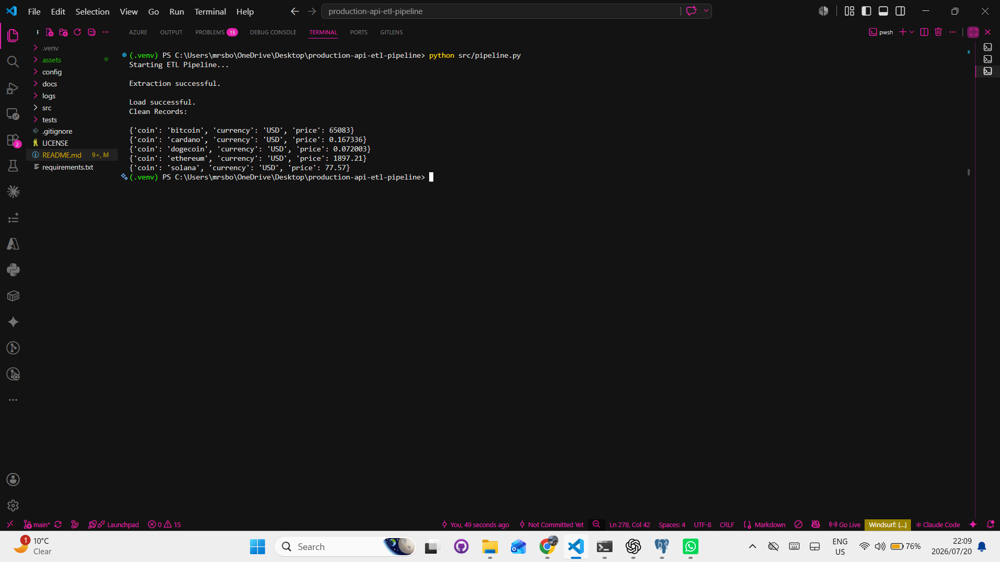
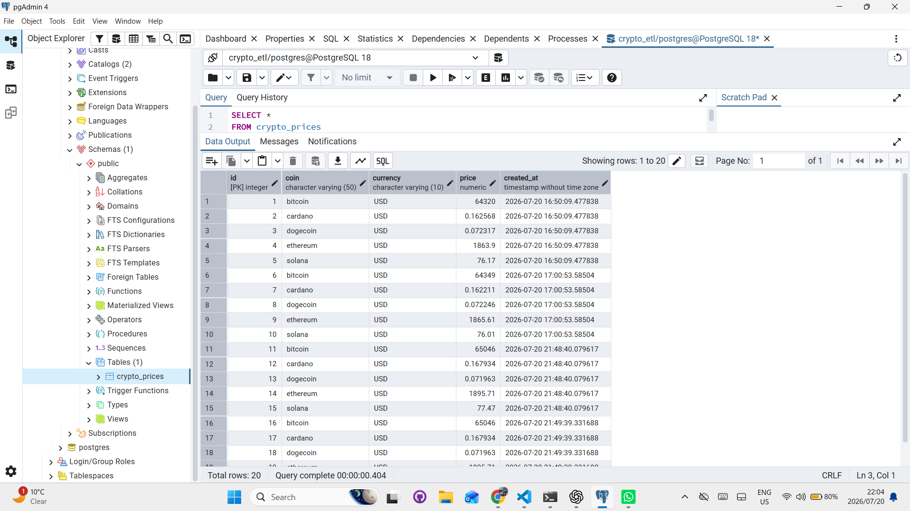
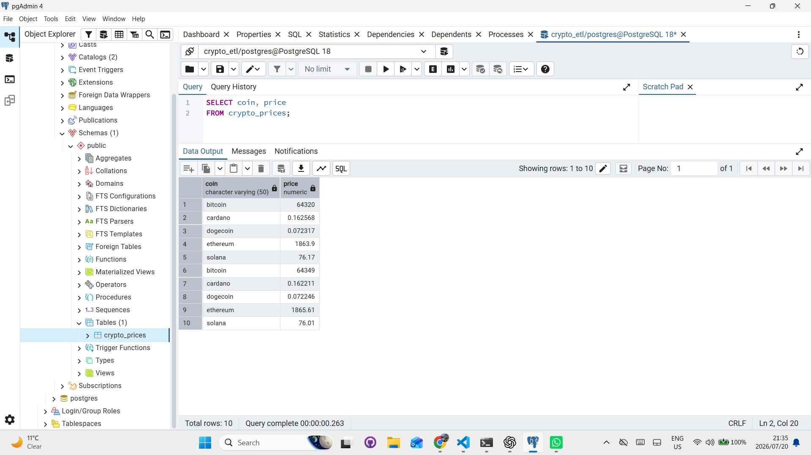
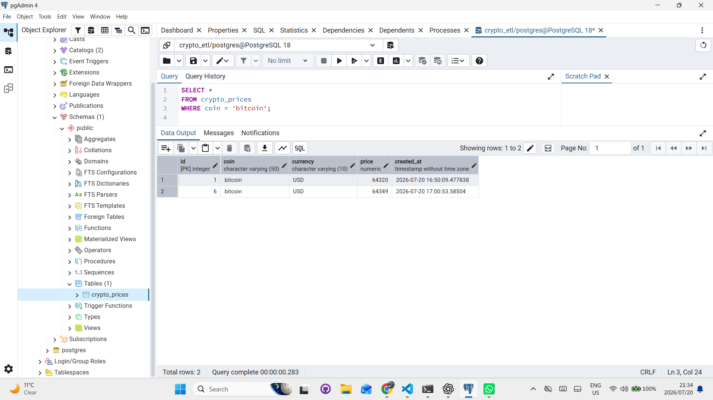
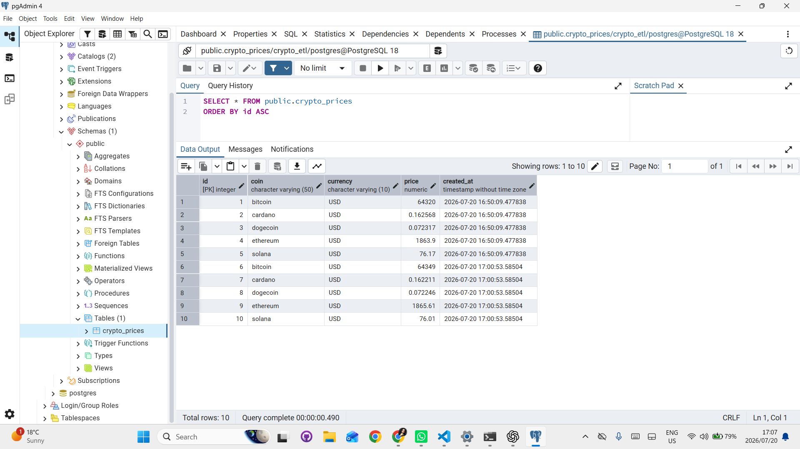
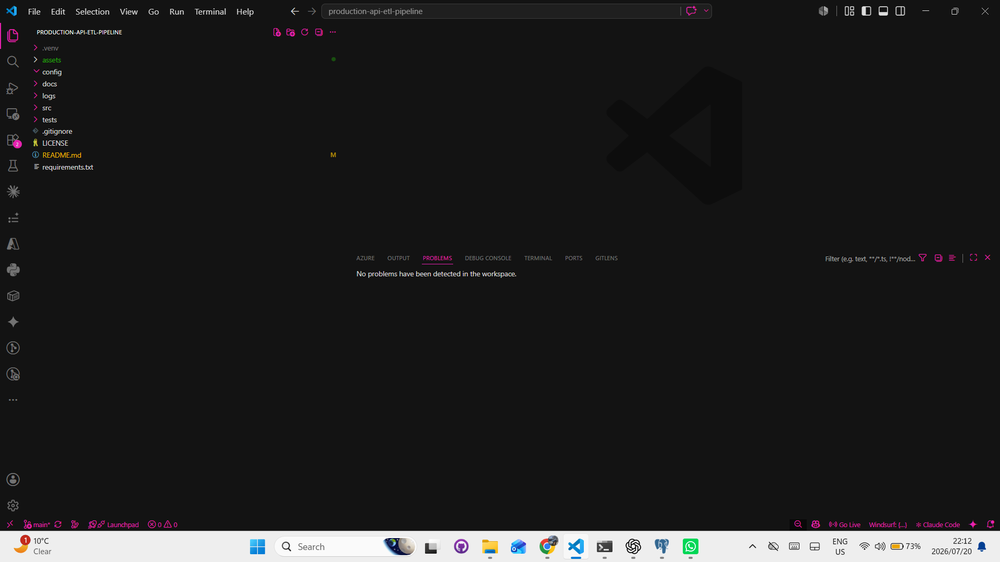

## WeThinkCode_ Data Engineering Elective — 2026

**Elective verification code:** `WTC-S9FESG9M`

This repository is submitted as evidence of my practical Data Engineering work for the WeThinkCode_ 2026 elective selection process.


## Reliability improvements — 26 October 2026

The transformation stage now validates CoinGecko payload structure, coin identifiers, and USD prices before any database writes. It rejects missing, negative, non-finite, boolean, and malformed values with actionable errors. Prices are represented with `Decimal` to avoid binary floating-point rounding in downstream database inserts.

Offline regression tests (no API key or PostgreSQL instance required):

```bash
python -m unittest discover -s tests -p "test_*.py" -v
```

These tests cover valid values, zero prices, empty responses, missing USD fields, invalid prices, empty coin identifiers, database configuration, and CoinGecko extraction errors. A live end-to-end run still requires a reachable CoinGecko API and configured PostgreSQL environment.


## Crypto Insights Explorer dashboard (26 October 2026)

An optional, read-only [Streamlit dashboard](dashboard.py) explores historical cryptocurrency snapshots already stored in PostgreSQL. It includes per-coin selection, 24-hour / 7-day / 30-day / all-time filters, price trend lines, a 7-observation moving average, latest price, range, snapshot-to-snapshot changes, volatility, and a latest-prices comparison table. The charts use **stored historical observations**, not invented live prices.

```bash
pip install -r requirements-dashboard.txt
# Set DB_PASSWORD, DB_HOST, DB_NAME, DB_USER and DB_PORT as for the ETL.
streamlit run dashboard.py
```

Alternatively, set `DATABASE_URL` to a PostgreSQL connection URL. Never commit database credentials. The dashboard caches database reads for 3600 seconds and provides a manual **Refresh data now** button. **This does not schedule the ETL job:** run `python src/pipeline.py` hourly on a machine with database access (e.g. a cron job or Task Scheduler). For example, a Linux crontab entry of `0 * * * * cd /absolute/path/to/repo && /absolute/path/to/venv/bin/python src/pipeline.py` requires the scheduler's environment or a `.env` file to provide database credentials. Use a hosted scheduler only after configuring persistent database access and secrets.

**Status:** Dashboard code and dependencies are committed, but deployment, database connectivity, hourly ingestion, and live UI verification have not yet been completed. Calculated percentage changes compare consecutive stored observations and should not be called 1-hour returns when collection gaps exist. The dashboard is for educational exploration, not trading advice.


### Automated collection and validation (29 October 2026)

GitHub Actions workflows have been added:

- [Hourly cryptocurrency ETL](.github/workflows/hourly-etl.yml) — manual dispatch, plus a schedule at minute 7 of every UTC hour that stays skipped until the `ETL_SCHEDULE_ENABLED` repository variable is `true`. Creates the table if needed, then runs the pipeline against an **externally reachable persistent PostgreSQL database**. Do not use `localhost` for a database hosted on your own laptop; GitHub runners cannot access it. GitHub's scheduled workflows may be delayed and are not a guaranteed exact hourly service.
- [Python ETL checks](.github/workflows/python-tests.yml) — syntax compilation and offline regression tests on pushes and pull requests.

To turn on hourly collection:

1. Store the hosted PostgreSQL URL, pasting it when prompted, and start a manual run.

   ```bash
   gh secret set DATABASE_URL
   gh workflow run hourly-etl.yml
   ```

2. Run `gh run watch` and confirm the run succeeds.
3. Enable the schedule only after that run succeeds.

   ```bash
   gh variable set ETL_SCHEDULE_ENABLED --body true
   ```

Instead of `DATABASE_URL`, you can set the `DB_HOST` and `DB_PASSWORD` secrets, and `DB_PORT`, `DB_NAME`, `DB_USER` when they differ from the defaults. Percent-encode special characters such as `/`, `@`, and `%` in a URL password. With Neon, `DATABASE_URL` is the pooled URL, and an optional `DATABASE_URL_UNPOOLED` secret lets the schema step use the direct connection. A managed database may require `?sslmode=require` on the URL or IP allowlisting. An optional `COINGECKO_API_KEY` secret reduces CoinGecko rate limiting.

GitHub disables scheduled workflows in a public repository after 60 days without repository activity. Re-enable collection with `gh workflow enable hourly-etl.yml`.

Extraction failures now cause the scheduled pipeline process to exit unsuccessfully rather than report a false green run. **Workflow files committed does not mean the secrets, database, hourly ingestion, or dashboard deployment are configured or verified.**

For a public dashboard, deploy `dashboard.py` on a Python/Streamlit-compatible hosting service, point it at the same persistent PostgreSQL database, and configure credentials in that host's private secrets (not in the repo). Streamlit Community Cloud is one possible option; account-side authorization and database connectivity still need configuration.

### Project overview

The Production API ETL Pipeline demonstrates an end-to-end data engineering workflow using Python, the CoinGecko API, PostgreSQL, and SQL.

The pipeline extracts cryptocurrency market prices, transforms API responses into structured records, validates the data, and loads it into PostgreSQL for historical analysis.

### Engineering practices

- Modular extraction, transformation, and loading
- Data validation before database insertion
- Environment-based database configuration
- Parameterized SQL queries and batch inserts
- Database transaction management and rollback
- Logging and error handling
- Git version control and incremental improvements

### Elective learning evidence

**IBM courses completed:**

1. Data Engineering Basics for Everyone
2. Relational Database Management Systems

**LinkedIn learning posts:**

- [Data Engineering Basics for Everyone](https://www.linkedin.com/feed/update/urn:li:activity:7506018227291021312/)
- [Relational Database Management Systems](https://www.linkedin.com/feed/update/urn:li:activity:7513221411101134848/)

**Development focus:** Continue improving reliability, automated testing, documentation, and SQL analytics through regular, meaningful commits.


# 🚀 Production API ETL Pipeline

A production-style ETL (Extract, Transform, Load) pipeline built with **Python** and **PostgreSQL** that retrieves live cryptocurrency market data from the CoinGecko API, transforms it into a structured format, and stores historical snapshots in a relational database for SQL analysis.

---

## 📖 Overview

This project demonstrates a complete data engineering workflow.

The pipeline:

- Extracts live cryptocurrency prices from the CoinGecko REST API
- Transforms nested JSON into clean Python records
- Loads data into PostgreSQL using parameterized SQL queries
- Stores historical price snapshots for future analytics
- Allows querying using SQL inside pgAdmin or psql

This project was built to practice real-world Data Engineering concepts including ETL pipelines, relational databases, SQL, API integration, logging, Git workflows, and modular software design.

---

# 🏗️ Architecture

```
                    CoinGecko API
                          │
                          ▼
                 Extract (extract.py)
                          │
                          ▼
                    Raw JSON Response
                          │
                          ▼
              Transform (transform.py)
                          │
                          ▼
               Clean Python Dictionaries
                          │
                          ▼
                 Load (load.py + SQL)
                          │
                          ▼
                   PostgreSQL Database
                          │
                          ▼
                   SQL Analytics Layer
```

---

# 📂 Project Structure

```
production-api-etl-pipeline/

│
├── assets/
│   ├── pipeline_run.png
│   ├── pgadmin-table.png
│   ├── project-structure.png
│   ├── sql-query.png
│   ├── sql-query-where.png
│   └── sql-query-ordered-asc.png
│
├── config/
│
├── docs/
│
├── logs/
│   └── pipeline.log
│
├── sql/
│   └── schema.sql
│
├── src/
│   ├── db.py
│   ├── extract.py
│   ├── init_db.py
│   ├── transform.py
│   ├── load.py
│   └── pipeline.py
│
├── tests/
│
├── .env.example
├── requirements.txt
├── LICENSE
├── README.md
└── .gitignore
```

---

# 🚀 ETL Workflow

## 1️⃣ Extract

Retrieve live cryptocurrency prices from the CoinGecko REST API.

Example response:

```json
{
    "bitcoin": {
        "usd": 65046
    }
}
```

---

## 2️⃣ Transform

Convert nested JSON into clean Python dictionaries.

Example:

```python
{
    "coin": "bitcoin",
    "currency": "USD",
    "price": 65046
}
```

---

## 3️⃣ Load

Insert transformed records into PostgreSQL using parameterized SQL.

```python
cursor.execute(
    """
    INSERT INTO crypto_prices
    (coin, currency, price)
    VALUES (%s, %s, %s)
    """,
    (
        record["coin"],
        record["currency"],
        record["price"]
    )
)
```

---

# 🗄 PostgreSQL Database Schema

Defined in [sql/schema.sql](sql/schema.sql). Create the table with `python src/init_db.py`; this is safe to run repeatedly and leaves an existing table unchanged.

```sql
CREATE TABLE IF NOT EXISTS crypto_prices (
    id SERIAL PRIMARY KEY,
    coin VARCHAR(50) NOT NULL,
    currency VARCHAR(10) NOT NULL,
    price NUMERIC NOT NULL,
    created_at TIMESTAMPTZ NOT NULL DEFAULT CURRENT_TIMESTAMP
);
```

A table created from the earlier schema has a `TIMESTAMP` column, and the dashboard reads those values as UTC. If the database is not set to UTC, run this once, using the database's time zone:

```sql
ALTER TABLE crypto_prices
    ALTER COLUMN created_at TYPE TIMESTAMPTZ
    USING created_at AT TIME ZONE 'Africa/Johannesburg';
```

---

# 📸 Project Demonstration

## ▶️ ETL Pipeline Execution

The complete ETL pipeline running successfully.



---

## 🗄 PostgreSQL Table

Historical cryptocurrency data stored inside PostgreSQL.



---

## 🔍 SQL Query

Retrieve every record.

```sql
SELECT *
FROM crypto_prices;
```



---

## 🔎 SQL WHERE Clause

Retrieve Bitcoin records only.

```sql
SELECT *
FROM crypto_prices
WHERE coin='bitcoin';
```



---

## 📈 ORDER BY

Sort results by ID.

```sql
SELECT *
FROM crypto_prices
ORDER BY id ASC;
```



---

## 📁 Project Structure

Visual overview of the project.



---

# 🛠 Technologies Used

- Python 3.13
- PostgreSQL 18
- SQL
- pgAdmin 4
- psycopg2
- Requests
- Git
- GitHub
- VS Code

---

# 📦 Installation

Clone the repository.

```bash
git clone https://github.com/Boitybanks/production-api-etl-pipeline.git
```

Navigate into the project.

```bash
cd production-api-etl-pipeline
```

Create a virtual environment.

```bash
python -m venv .venv
```

Activate the environment.

### Windows

```bash
.venv\Scripts\activate
```

Install dependencies.

```bash
pip install -r requirements.txt
```

Copy `.env.example` to `.env`, fill in your database password, and create the table.

```bash
python src/init_db.py
```

---

# ▶️ Run the ETL Pipeline

```bash
python src/pipeline.py
```

Expected output:

```
Starting ETL Pipeline...

Extraction successful.

Load successful.

Clean Records:

{'coin': 'bitcoin', 'currency': 'USD', 'price': 65046}
...
```

---

# 🧠 SQL Examples

Retrieve all records.

```sql
SELECT *
FROM crypto_prices;
```

Retrieve specific columns.

```sql
SELECT coin,
       price
FROM crypto_prices;
```

Retrieve Bitcoin prices.

```sql
SELECT *
FROM crypto_prices
WHERE coin='bitcoin';
```

Sort results.

```sql
SELECT *
FROM crypto_prices
ORDER BY id ASC;
```

Count records.

```sql
SELECT COUNT(*)
FROM crypto_prices;
```

Retrieve latest prices.

```sql
SELECT *
FROM crypto_prices
ORDER BY created_at DESC;
```

Retrieve highest Bitcoin price recorded.

```sql
SELECT MAX(price)
FROM crypto_prices
WHERE coin='bitcoin';
```

---

# 📊 Skills Demonstrated

This project demonstrates:

- ETL Pipeline Design
- REST API Integration
- Data Extraction
- JSON Transformation
- Relational Databases
- PostgreSQL
- SQL
- Parameterized SQL Queries
- Database Design
- Logging
- Git Version Control
- GitHub Workflow
- Modular Python Programming
- Data Engineering Fundamentals

---

# 🎯 What I Learned

While building this project I gained practical experience with:

- Building a modular ETL pipeline
- Consuming third-party APIs
- Understanding nested JSON structures
- Transforming raw data into structured records
- Creating PostgreSQL databases
- Designing relational tables
- Writing SQL queries
- Using parameterized SQL safely
- Loading data into PostgreSQL
- Querying databases using pgAdmin
- Git branching, commits and pushes
- Organizing production-style Python projects

---

# 🚀 Future Improvements

Planned enhancements include:

- Docker support
- Configuration management layer
- YAML configuration files
- Scheduling with Cron / Windows Task Scheduler
- Apache Airflow orchestration
- Unit and integration testing
- Data validation
- Logging improvements
- CI/CD with GitHub Actions
- AWS EC2 deployment
- AWS RDS PostgreSQL
- AWS S3 Data Lake
- Dashboard using Streamlit
- Historical price analytics
- Data visualization

---

# 📚 Concepts Covered

- ETL
- APIs
- JSON
- Python
- SQL
- PostgreSQL
- Database Design
- Parameterized Queries
- Logging
- Git
- GitHub
- Data Engineering

---

# 👨‍💻 Author

## Boitumelo Banks

Junior Software Engineer • Aspiring Data Engineer • Cloud Computing Student

GitHub:

https://github.com/Boitybanks

---

# ⭐ If you found this project interesting

Feel free to fork the repository, leave a star ⭐, or contribute improvements.